# ShelfSight

ShelfSight helps agencies investigate AI recommendations for Indian beauty and skincare brands.
It collects API answers, records reported citations and independent search proxies, and proposes
hypotheses to investigate. It does not establish why a model included or excluded a brand.

## Evidence contract

- Direct observations: returned answer text, reported search queries and citation URLs.
- Extractor interpretations: named brands, recommendations and ranks, with versioned replay provenance.
- Proxy measurements: SearxNG results for reported queries. `is_eligible`, `eligible_n` and legacy diagnosis
  identifiers are compatibility names, not access to the answer engine's candidate set.
- Causal hypotheses: separate from observations; no automatic content-gap, authority or training-data conclusion.
- Missing citations do not establish reliance on training data. No calibrated confidence is available.
- Visibility, citations, referral traffic and purchases are distinct measures. Business impact is unmeasured.

See [the verified assessment](docs/reliability-assessment.md) for scope, gaps and remaining limitations.
Historical design documents and sample briefs are not validation evidence.

## Reproducible local intervention

From this editable worktree, with the existing Python environment:

```powershell
.venv\Scripts\python.exe -m pytest -q
.venv\Scripts\python.exe scripts/eval_replay.py --output data/extractor-replay.json
.venv\Scripts\python.exe scripts/intervention_example.py --output data/intervention-demo
```

Use a fresh output directory for every example run. All example answers, product facts, approvals and
publication records are synthetic. No network calls, credentials or paid services are required.
The output includes an append-only lake, proposal.json, a SQLite event ledger, assessment.json and README.md.
The local publication is an immutable content artifact in the ledger, never a brand-site deployment.

For a real locally reviewed proposal, supply a JSON document matching `Proposal` in
`src/shelfsight/interventions.py`. Direct observations must match the local lake; brand facts require
snapshots, exact quotations, capture times and named verification attestations for the exact page.
The constrained publisher emits only supported quotations. Unverified ingredients and suitability stay unknown.

```powershell
python -m shelfsight.interventions --ledger data/interventions.sqlite propose proposal.json --actor reviewer --lake data/lake
python -m shelfsight.interventions --ledger data/interventions.sqlite approve CHANGE_ID --actor approver
python -m shelfsight.interventions --ledger data/interventions.sqlite publish-local CHANGE_ID --actor publisher
python -m shelfsight.interventions --ledger data/interventions.sqlite show CHANGE_ID
python -m shelfsight.outcomes --lake data/lake --ledger data/interventions.sqlite --id CHANGE_ID --output assessment.json
```

Plans specify baseline/post dates, target/comparison questions and pages, and model, prompt and collection
versions before post observations. The first implementation expects exactly one observation per question/day.
Repeated observations occur across days. Duplicate cells, failed/missing runs and changed/unknown settings are
reported rather than treated as zeros. Differences require complete cells and at least seven days per window
by default. Difference-in-differences is descriptive; the causal verdict remains inconclusive.

Approver identity is a local attestation, not authentication. The ledger prevents duplicate or out-of-order
transitions through the interface; a user with database access can edit the file. It is not a tamper-proof audit service.

## Extractor validation and version migration

`eval_replay.py` checks synthetic outputs through reconciliation and saved provider citation fixtures through
the parser. Its scores are regression checks, not live model accuracy. `eval_extractor.py --predictions ...
--output ...` scores reviewed labels against saved predictions and retains errors and provenance. Live evaluation
requires the explicit `--live` switch, uses the configured extractor, and can incur charges. It was not run here.

New defaults are `ext-3-evidence` and `join-2-evidence`. Old rows and files are preserved. Reports filter by
current versions, so historical results require explicit re-extraction/re-derivation or use of their old config;
changing a version string does not validate or migrate old results. New extraction rows retain the prompt,
schema, model, output, answer hash and brand configuration. Older rows lack this provenance.

## Existing operational code (not deployment verification)

The following describes checked-in infrastructure and collection interfaces. Deployment and account state
have not been checked. These commands call external services; they are not needed for the local example.

## Architecture on AWS

One CDK stack. No inbound ports: administration goes through SSM Session Manager, so n8n's credentials
are never exposed to the internet.

```mermaid
flowchart TB
  subgraph AWS["AWS · us-east-1"]
    subgraph EC2["EC2 t4g.small · Elastic IP · no inbound"]
      BR[bridge container<br/>shelfsight serve]
      SX[SearxNG]
      N8[n8n]
    end
    S3[(S3 Parquet lake<br/>retained on stack delete)]
    ECR[(ECR image)]
    SSM[SSM Parameter Store<br/>SecureStrings]
    BED[Bedrock<br/>Nova 2 Lite + web grounding]
    N8 --> BR
    BR --> SX
    BR --> S3
    BR --> BED
    EC2 -. instance role .-> SSM
    EC2 -. pull .-> ECR
  end
  GEM[Gemini API<br/>free tier]
  OP["operator laptop<br/>SSM port forward"]
  BR --> GEM
  OP -. 5678 .-> N8
```



**Why these choices**

- **Elastic IP**: the retrieval probe needs a stable identity, or search engines start challenging it.
- **`language=en-IN` on every probe**: a US-hosted probe returns US results. Left unfixed it would have
  quietly measured the wrong market — the defect that matters most in this system.
- **Parquet on S3, read with DuckDB**: no warehouse to pay for, and the lake survives instance
  replacement. A day of data is a few hundred KB.
- **Secrets in SSM SecureStrings**, read at boot by the instance role: nothing in git, no long-lived keys
  on the box.
- **Instance role for Bedrock**: no expiring developer credentials in the daily path.

### Data model

| Table | One row per | Written by |
|---|---|---|
| `runs` | daily run: status, coverage, quota, cost signals | collect |
| `raw_responses` | prompt × engine × mode (append-only, never edited) | collect |
| `candidates` | URL returned by independent search for a reported query | probe |
| `citations` | Provider-reported citation URL; unresolved links remain unresolved | collect |
| `mentions` | brand named in an answer, with rank, sentiment, claims | extract |
| `funnel` | answer × tracked brand, with its diagnosis | funnel joiner |

Layout: `s3://bucket/lake/{table}/workspace={w}/run_date={d}/*.parquet`

---

## Running it

### On a laptop

```bash
uv sync
docker compose -f infra/searxng/docker-compose.yml up -d
export GEMINI_API_KEY=...            # Google AI Studio, free tier
uv run python scripts/smoke_gemini.py   # checks the model still returns its own queries
uv run python scripts/smoke_nova.py     # same for Nova on Bedrock (needs AWS credentials)
uv run shelfsight collect --workspace dotandkey --limit 3
uv run shelfsight extract --workspace dotandkey
uv run shelfsight funnel  --workspace dotandkey
uv run shelfsight report  --workspace dotandkey
```

`uv run pytest` runs the offline test suite. Live checks live in `scripts/` and never run in CI.

### Page lookup

Paste a page URL and see everything stored about it: the independent searches that found it and at what position,
where it was cited, the brand's diagnosis per answer, independent searches without a sampled brand hit, who wins
instead, which sources they cite, and a live check of the page against the claims that win.

```bash
export SHELFSIGHT_BRIDGE_TOKEN=...      # any secret; the page asks for it once
uv run shelfsight serve                 # then open http://127.0.0.1:8765/
uv run shelfsight --lake s3://<bucket>/lake serve   # same, over every run on AWS (needs aws login)
```

It reads stored runs and fetches the page for an exact-phrase check; that check does not verify product claims. A URL works when a brand in `config/workspaces/` owns
it (its domain or a marketplace `url_pattern`); other URLs say "not tracked yet".

### On AWS

```bash
aws ssm put-parameter --name /shelfsight/bridge_token   --type SecureString --value file://token.txt
aws ssm put-parameter --name /shelfsight/gemini_api_key --type SecureString --value file://gemini.txt
cd infra/cdk && cdk deploy
```

Then reach n8n through the tunnel (needs the AWS Session Manager plugin):

```bash
aws ssm start-session --target <instance-id> --document-name AWS-StartPortForwardingSession --parameters "{\"portNumber\":[\"5678\"],\"localPortNumber\":[\"5680\"]}"
```

Create the n8n owner account and an SMTP credential, then deploy the workflows:

```bash
uv run --env-file .env python scripts/n8n_deploy.py
```

### Configuration

| File | Holds |
|---|---|
| `config/config.yaml` | engines, pinned model ids, per-engine daily caps, probe settings, domain types |
| `config/workspaces/<id>.yaml` | the client brand, competitors, aliases, domains, marketplace URL patterns |
| `data/prompts_seed.csv` | the versioned prompt library |
| `.env` (git-ignored) | local secrets for the bridge and the n8n deploy |

Adding a client is a new workspace YAML. Adding a category is a new prompt set. Neither needs code.

---
